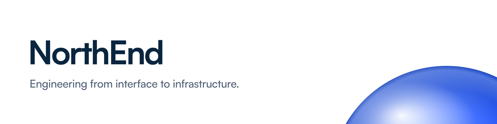

<picture>
  <source media="(prefers-color-scheme: dark)" srcset="assets/header-dark.jpg">
  
</picture>

I'm Drew, Principal at **[NorthEnd Technologies](https://northend.tech)**. I build the whole stack a business runs on: the website, the application behind it, the data pipelines that feed it, and the automation that ties it together.

**Web engineering** · **Data systems** · **Workflow automation**

Recent work: [SafeDine](https://safedine.ai), which turns official restaurant inspection records into one clear safety profile per restaurant.

[northend.tech](https://northend.tech) · [LinkedIn](https://www.linkedin.com/company/northend-tech) · hello@northend.tech
